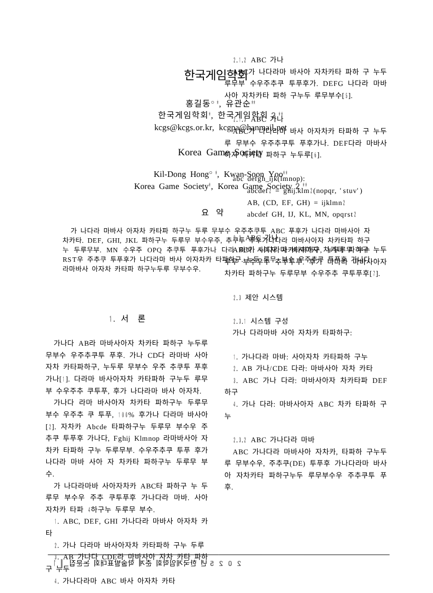
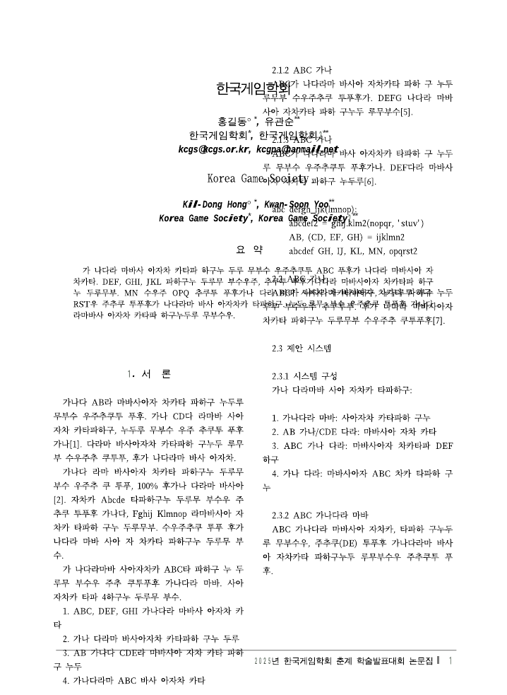
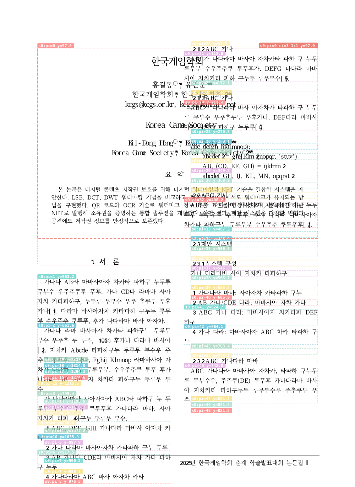

# 2단 구역 + 쪽 기준 전폭 어울림 표 → 오른쪽 단이 표 위에 겹치고 왼쪽 단이 쪽 밖으로 넘침

upstream 이슈 [edwardkim/rhwp#7282](https://github.com/edwardkim/rhwp/issues/7282)
(종이 기준 표·그림 주위로 본문이 비켜 흐르지 않음)의 **두 번째 재현 사례**.
한국게임학회 논문 양식(hwp)에서 나타난다. 아래 댓글 초안은 그 이슈에 붙이기 위한 것.

- 재현 파일: [`tests/fixtures/kgs-paper-template-dummy.hwp`](../../../tests/fixtures/kgs-paper-template-dummy.hwp)
  (본문·요약·참고문헌·미리보기·그림·요약정보 전부 더미로 치환한 합성 파일, 116,224 bytes)
- CI: `.github/workflows/rhwp-devel-render.yml` — upstream devel HEAD CLI로 이 파일을 렌더해 아티팩트로 남김
- 우리 번들: 서일 오피스 0.4.1 (이음오피스 vendor rhwp-core devel 7d06d5c)
- upstream: devel `e4ffabea38062e716f6c333cc950fa31b42b4dd7` (2026-11-07) CLI `rhwp v0.9.0`, `cargo build --profile release-test --bin rhwp`

| 서일 오피스 0.4.1 (wasm) | upstream devel e4ffabe (native `export-pdf`) | debug overlay |
|---|---|---|
|  |  |  |

---

## #7282 댓글 초안

같은 증상의 두 번째 재현 파일입니다. 한국게임학회 논문 양식(hwp)인데, 본문·요약·참고문헌·미리보기·그림·요약정보를 전부 더미(가나다/abc, 홍길동·유관순)로 바꾼 합성 파일이라 공개해도 됩니다.

- 재현 파일: https://github.com/HvsOdream/hwp-pad/raw/main/tests/fixtures/kgs-paper-template-dummy.hwp (HWP5, 116,224 bytes)
- 확인한 버전: devel `e4ffabe` (2026-11-07) CLI `rhwp v0.9.0` native `export-pdf`, 그리고 wasm 0.9.0-devel(7d06d5c) 둘 다 동일
- 실행: `rhwp export-pdf kgs-paper-template-dummy.hwp -o out.pdf` (Linux, 글꼴 미공급 — 글꼴과 무관한 구조 결함)

**문서 구조** (`rhwp dump --section 0 --para 0`)

- 구역은 처음부터 **2단**(`단정의: 2단, 유형=일반, 간격=7.0mm, 같은너비=true`). 쪽 중간 단 전환 없음.
- 첫 문단(「1. 서 론」)에 1×1 표: `treat_as_char=false, wrap=어울림(Square), vert=쪽(273=1.0mm), horz=쪽(0), size=42556×28824 (150.1×101.7mm)` — 본문 전폭이라 두 단에 걸침. 표 안에 제목·저자·요약(내부 4×4 표).
- 저장된 첫 줄 `ls[0]: vpos=29097` (102.6mm) — 한/글은 「1. 서 론」을 표(101.7mm) 바로 아래에 놓음. 다음 문단들도 `vpos=32243…`로 이어짐.

**rhwp 결과** (page 1)

1. 오른쪽 단(col 1)이 body 상단 `y=93.3`부터 시작해 표(요약) 위에 그려짐 — #7282 에서 말한 "배제 띠가 단마다 따로여서 오른쪽 단이 표를 못 봄" 그대로입니다. 이쪽은 TopAndBottom 이 아니라 **Square(어울림)** 인데도 같습니다.
2. 왼쪽 단(col 0)은 표 아래에서 시작하지만 **단 높이가 줄지 않아** 쪽 바닥(`bottom=892.0`)을 넘겨 `y=1333.7`까지 내려갑니다. stderr:
   ```
   LAYOUT_OVERFLOW: page=0, sec=0, col=0, para=5,  type=FullParagraph, y=909.8,  bottom=892.0, overflow=17.8px
   …
   LAYOUT_OVERFLOW: page=0, sec=0, col=0, para=19, type=FullParagraph, y=1333.7, bottom=892.0, overflow=441.7px
   ```
   문단 5~19가 쪽 밖에 그려져 사라지고, 오른쪽 단은 문단 20(2.1.2)부터 시작합니다. 한/글은 문단 5~19를 오른쪽 단 위쪽에 둡니다.
3. render tree: `Column col=0 bbox {y:93.3,h:798.6}`, `Column col=1 bbox {y:93.3,h:798.6}` 로 두 단 모두 전체 높이. 표 `bbox {x:75.6,y:97.0,w:567.4,h:384.3}` 는 col 0 의 자식으로만 들어감.

(이미지: 우리 wasm 렌더 / devel e4ffabe native 렌더 / `--debug-overlay`)


한/글 기준 화면은 (추가 예정).

이 양식은 학회 공식 양식이라 투고자 전원이 같은 구조의 문서를 만듭니다. 단 간 공용 배제 채널 설계가 정해지면 테스트 사례로 써 주세요.
